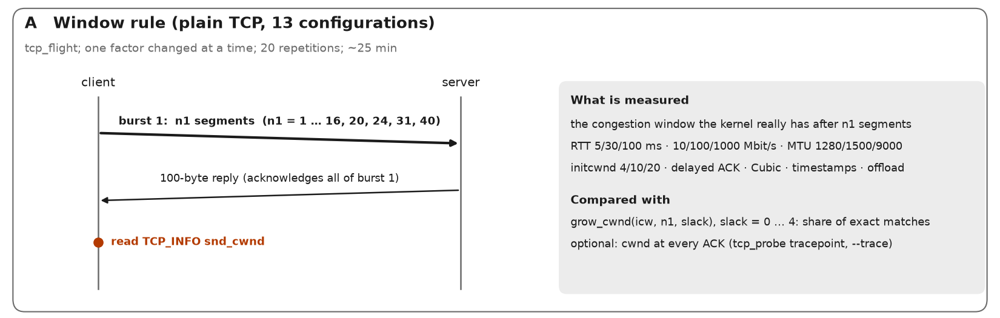
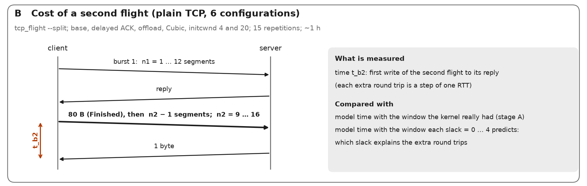
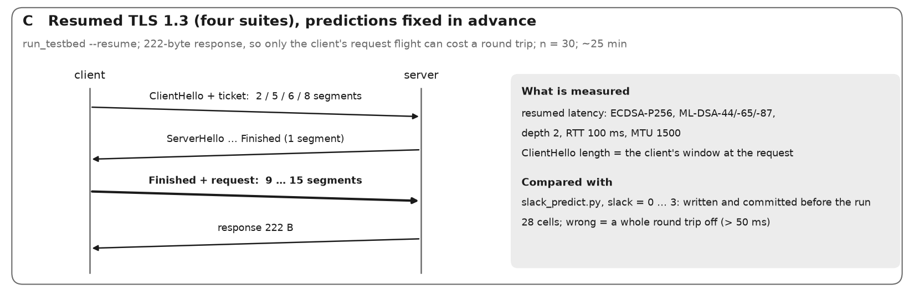

# Testbed: real OpenSSL 3.5 TLS 1.3 transactions over an emulated network

Purpose (paper 1, section "Testbed calibration"): check the transport model of `../../Simulation/pqc_sim.py`
against real handshakes that run through the Linux TCP stack over a link with controlled RTT, rate, MTU, loss
and initial window, and estimate the middlebox penalty (`pi`, `theta`) that the model leaves as a free parameter.

Target machine: Linux Mint, Core i7-5600U (2 cores / 4 threads), 8 GB RAM, root (sudo) available.

## What runs
```
client ns (pqcc) --vc0 ==== vs0-- server ns (pqcs)          topology "direct"
client ns (pqcc) --vc0 ==== vp0-- proxy ns (pqcp: HAProxy) --vp1 ==== vs0-- server ns    "proxy-tcp" / "proxy-inspect"
```
* IPv6 everywhere, TCP timestamps off -> MSS = MTU - 60, exactly the 40 + 20 header bytes of the model.
* `tc netem` (delay RTT/2 per direction, `rate`, `loss`) on both ends of the client link; GSO/TSO/GRO off.
* Per-peer routes: `initcwnd`, `initrwnd 100` (the model has no receive-window limit), `congctl reno`
  (the model is ACK-clocked slow start), `quickack 1`.
* `tls_probe` (C, OpenSSL 3.5): new TCP connection + full TLS 1.3 handshake (no tickets) + one request/response
  (default 302/222 B = ISO 8583 0200/0210), mutual TLS with the real DER chains of `../certs/`.
  It reports `t_tcp`, `t_hs`, `t_total`, bytes, and the MSS / initial cwnd the kernel actually used.
* Client and server are pinned to different physical cores (`lscpu`), HAProxy to the sibling thread.

## Procedure
```bash
cd Measurements/testbed
./setup_host.sh                      # once: packages, OpenSSL 3.5 in ~/opt, tls_probe, certificates
sudo ./host_tune.sh on               # performance governor, no turbo (restored by "off")
./check_env.sh                       # netns/netem/route metrics + one shaped transaction
sudo python3 run_testbed.py --profile smoke                       # ~2 min
python3 analyze_testbed.py results/testbed_raw.csv                # first look at model vs measurement
sudo python3 run_testbed.py --profile core --n 30                 # a few hours; resumable (re-run the same command)
sudo python3 run_testbed.py --profile proxy --topology proxy-tcp  # real middlebox (HAProxy, TCP proxy)
sudo python3 run_testbed.py --profile proxy --topology proxy-inspect   # HAProxy waiting for the full ClientHello
sudo python3 run_testbed.py --profile loss --n 200                # loss tails
python3 analyze_testbed.py results/testbed_raw.csv
sudo ./host_tune.sh off
```
`--list` prints the number of configurations and a time estimate; any axis can be overridden, for example
`--rtts 30 --rates 100 --mtus 1500 --depths 1,2,3,4 --suites "ML-DSA-65|ML-KEM-768"`.
`--profile full` (both mutual-TLS modes, initial window 10 and 32) takes about a night.

Do not use the machine for anything else during a run (two cores only), keep it on mains power, and let it
cool down if `host_tune.sh status` shows throttled frequencies.

### First-run validation with tcpdump (recommended once)
```bash
sudo python3 run_testbed.py --profile smoke --suites "ML-DSA-65|ML-KEM-768" --depths 3 --rtts 100 --n 3 --keep &
sleep 8; sudo ip netns exec pqcc tcpdump -i vc0 -nn -c 80 'tcp port 4433'   # while it runs
```
The server's first flight must be 10 segments of 1440 B, then a pause of one RTT before more data.
`sudo python3 tbnet.py down` removes the namespaces (also done automatically at the end of a run).

## Outputs (`results/`)
| file | content |
|---|---|
| `testbed_raw.csv` | one row per transaction (compress with gzip before committing a full sweep) |
| `env.json` | kernel, CPU, governor, turbo, OpenSSL version, arguments |
| `testbed_summary.csv` | median / p10 / p90 per configuration |
| `model_vs_testbed.csv` | measured excess latency vs model (T - T_cpu), size check, round-trip equivalents |
| `model_vs_testbed_stats.txt` | bias, MAE, relative error, Spearman rank correlation per suite, worst cases |
| `pi_theta_fit.csv` | least-squares `pi` for every threshold `theta` on the direct path |
| `proxy_delta.csv` | latency added by the real middlebox over the direct path (+ fit of pi, theta) |
| `model_vs_testbed.png` | scatter |

## How the comparison works
Excess = median time of a shaped configuration - median time of the unshaped "base" run of the same suite,
depth and mutual-TLS mode. Computation and library overhead lie on the critical path in both and cancel.
It is compared with `T - T_cpu` of `pqc_sim.run_flow()` for the same flow, link, MTU and initial window.
`size_ratio` compares the model's L7 bytes with the TLS bytes read and written by the client (expected 0.95-1.06).
If the direct path gives a fitted `pi` near 0, the kernel path supports the lower bound `pi = 0`; a real middlebox
adds latency (`proxy_delta.csv`), which is the empirical estimate of `pi` and `theta`.

## Known limits (state them in the paper)
* Only one pair of cores: client and server share the CPU package; the base run removes the common cost.
* netem `rate` counts the Ethernet header (14 B per packet) that the model does not; negligible at 1500 B, about 1 % at 1280 B.
* Reno with quickack, no timestamps and a large receive window is the closest Linux match to the model, not what
  production servers run (CUBIC, delayed ACK, timestamps): add `--cc cubic` runs to quantify the difference.
* HAProxy in TCP mode is one real middlebox, not all of them; the penalty is specific to it.
* `tbnet.py` and the proxy mode could not be run on the development machine (no root there). The probe, the
  orchestrator and the analysis were tested on loopback. If `check_env.sh` or the smoke run reports a problem
  with the namespace setup, fix `tbnet.py` first (every command it runs is shown by `python3 tbnet.py up --dry-run`).

## Extra TCP settings (revision of paper 1)

`run_variants.sh` repeats part of the grid with other kernel settings: CUBIC on a wider grid (`cubic2`), delayed ACKs (`delack`),
TCP timestamps (`ts`, MSS = MTU - 72) and both (`delack_ts`), optionally BBR (`BBR=1`, exploratory). `analyze_variants.py` compares each
variant with the stack model and, configuration by configuration, with the Reno / quick-ACK / no-timestamps measurements.

    sudo ./host_tune.sh on            # as before the other runs; "sudo ./host_tune.sh off" afterwards
    sudo bash run_variants.sh         # about 2 hours; resumable
    python3 analyze_variants.py       # no root; writes results/variants_summary.csv and the LaTeX table/numbers

## Session resumption (paper 2, WP1)

`tls_probe --resume` (both sides) measures RESUMED transactions: the client first runs a full transaction on its own connection to
obtain a TLS 1.3 ticket, then opens a new TCP connection that offers it (PSK with (EC)DHE key exchange, server tickets stateless; under
mutual TLS OpenSSL puts the client certificate in the ticket). The row of the resumed transaction carries `reused` (1 if the session
really was resumed; otherwise the row is an error `not_resumed`) and `prime_ms`, the total time of the full transaction just before it,
under the same network conditions. `run_testbed.py --resume` selects it; `run_resume.sh` runs the grids of paper 2 (about an hour);
`analyze_resume.py` compares the measurements with the stack model (`mode "resumed"`) and with the full handshake. Rebuild `tls_probe`
(`./setup_host.sh`) after pulling.

## Server capacity (paper 2, WP2)

`tls_serve` is an event-driven (epoll, non-blocking) TLS 1.3 server, one thread per process (`--reuseport` + `taskset` per core);
`tls_load` is a multi-threaded closed-loop load generator (new connection, handshake full or resumed, one request/response, close);
`capacity_test.py` starts the servers pinned to the server cores, saturates them from the other cores and reads the CPU time and the
number of completed transactions of each server process with SIGUSR1 over a measurement window. `analyze_capacity.py` compares the
CPU per transaction with the sum of the measured primitive costs. `run_capacity.sh` has the commands for the i7-5600U and the Arm
platform. Loopback only: it measures TLS, kernel and event-loop cost of the server, not NIC and interrupt cost of a real path.
`tls_probe server --reuseport` (blocking, one connection at a time) is kept for comparison (`capacity_test.py --server tls_probe`).

## WP5 — does the kernel grow the window after a 5-segment flight? (Paper 2, `cwnd_slack`)

Hypothesis (from the resumed ISO 20022-sized test, see `STATUS.md`): the transport model's rule "slow start grows cwnd only while cwnd < 2 x
segments in flight" is met exactly at the boundary by a 5-segment ClientHello, and the data behave as if the window had grown (`Net.cwnd_slack = 2`).
Three independent measurements, from the most direct to the most applied:

  

| Stage | What | Tool | Time |
|---|---|---|---|
| A | window the kernel actually has after n1 = 1..40 segments (`TCP_INFO snd_cwnd`), 13 configurations changing one factor at a time (RTT, rate, MTU, initcwnd, delayed ACK, Cubic, timestamps, offload) | `run_slack.py` + `tcp_flight` | ~25 min |
| B | cost of a second flight after n1 = 1..12 (n2 = 9..16; 3..12 for initcwnd 4, 17..24 for initcwnd 20; Finished write first, as TLS does), 6 configurations | `run_slack.py --stage B` | ~1 h |
| C | resumed TLS 1.3, request flight 9..15 segments, 4 suites with ClientHello of 2/5/6/8 segments; **predictions fixed in advance** | `slack_predict.py` (before), `run_slack_tls.sh` | ~25 min |

```
python3 slack_predict.py                      # once; commit results/slack_predictions.csv BEFORE measuring (refuses to overwrite)
sudo ./host_tune.sh on
sudo python3 run_slack.py --stage A,B --trace   # --trace: per-ACK snd_cwnd from the tcp_probe tracepoint (best effort, base configuration)
sudo bash run_slack_tls.sh
sudo ./host_tune.sh off
python3 analyze_resume.py --out results/resume_summary_slack_tls.csv results/slack_tls.csv
python3 analyze_slack.py                      # per-stage best slack and a verdict
```
Read the verdict conservatively: the hypothesis stands only if stages A, B and C name the same slack, the factors the model covers do not change it,
and stage C's pre-registered predictions for that slack are right. If delayed ACK, Cubic or offload change the window rule, say so in the paper as
a limit. Preliminary look on a loopback/Cubic machine (not the testbed): n1 = 5 gave cwnd 10 (no growth), n1 = 6 gave 16 — the rule on that
stack is not the model's, so expect factor dependence.

### WP5 results (Mint, kernel Linux 7.0.0-42, 2026-11-01) and stage D

- **Stage A** (14,200 plain-TCP connections, 13 configurations): the window after an n-segment flight is `max(w0, min(w0 + n, 2n))`, exactly, in 12 of 13 configurations (RTT 5–100 ms, 10 Mbit/s–1 Gbit/s, MTU 1280/1500, initcwnd 4/10/20, delayed ACK, Cubic, timestamps, offload); at MTU 9000 it is lower (35% of the flights match). The model's `grow_cwnd` differs by one segment at odd n > 10; none of the 238 Paper 1 validation configurations is affected (MAE 1.696 ms either way).
- **Stage B**: time of a second flight is explained by the window the kernel really has (MAE 0.24–0.37 ms); the loosened rules (slack 1–4) are worse.
- **Stage C** (pre-registered, 28 cells): slack 0 MAE 0.30 ms, no cell a round trip wrong; slack 2 MAE 14.45 ms, 4 cells a round trip wrong. **The slack hypothesis is refuted.** Output of `analyze_slack.py`: `results/slack_analysis.txt`.
- What explains the ISO 20022 error instead (not yet confirmed): the NewSessionTicket is its own write, sent when the client's Finished arrives. If the client's request flight needs an extra round trip, the ticket is already acknowledged when the response leaves. Model: `Net.nst_early` (`STACKS["linux-openssl-2"]`); on the 144 resumed configurations MAE 1.42 → 0.54 ms (max 98.8 → 0.8 ms), but it was formed after seeing that data.
- **Stage D** (confirmatory, predictions fixed in advance): `python3 nst_predict.py` (done; commit `results/nst_predictions.csv` before measuring), then `sudo bash run_nst_tls.sh` (~50 min), `python3 analyze_resume.py --out results/resume_summary_nst_tls.csv results/nst_tls.csv`, `python3 analyze_nst.py`. 80 cells, 10 on which the two models differ by a round trip.

### Stage D result (Mint, 2026-11-01; predictions committed 17:18, data committed 18:26)
`analyze_nst.py` (output in `results/nst_analysis.txt`): 80 cells, 10 on which the two models differ by a round trip. **H_early (ticket written when the client's Finished arrives) is right on all 10; H_joined (ticket with the response) is wrong on all 10.** Mean error over the 80 cells 5.5 ms against 17.8 ms. Both models are wrong by a round trip on the same 4 cells (ML-DSA-44 and -65, 19,460-byte request, responses of 11 and 12 segments): the transaction paid one extra round trip where the models charge two, so the server's window was larger than ten segments after the ticket had been acknowledged. Unexplained.
**Stage E (suggested, ~25 min):** resumed TLS, ML-DSA-44/-65, request 19,460 B, responses of 10 to 18 segments, plus ECDSA-P256 as control (ticket of 1 segment), to find where the server flight starts to cost a round trip after an acknowledged ticket.
**File names:** `resume_summary_earlyticket.csv` is the 144-configuration summary of the early-ticket model (Paper 2); `resume_summary_nst_tls.csv` is stage D. Both were once called `resume_summary_nst.csv`, and a run overwrote one with the other: always pass `--out`.

### Stage E (prepared; to run on Mint)
Question: after the ticket has been acknowledged, how large is the server's window for the response? Stage D left four cells (ML-DSA-44/-65, 19,460-byte request, 11–12 segments) on which both models were a round trip wrong.
```
python3 nst_predict_e.py      # done: results/nst_predictions_e.csv (72 cells, 24 where the window hypotheses W = 10, 12, 14, 16, 20 differ); COMMIT AND PUSH IT BEFORE MEASURING
sudo ./host_tune.sh on
sudo bash run_nst_e.sh        # ~45 min, resumable, writes results/nst_e_tls.csv
sudo ./host_tune.sh off
python3 analyze_resume.py --out results/resume_summary_nst_e_tls.csv results/nst_e_tls.csv     # --out is required
python3 analyze_nst_e.py      # series, extra round trips, best W per suite, control
```
Design: ECDSA-P256 (ticket 1 segment), ML-DSA-44/-65 (4, 5), ML-DSA-87 (6; control: its client flight fits the window, so the ticket is not yet acknowledged), request 302 B (control) and 19,460 B, responses of 10 to 18 segments, 30 transactions per cell. `Net.srv_cwnd_acked` is the knob of the model.

### Stage E result (Mint, 2026-11-01; predictions committed 18:38, data committed 19:51)
`analyze_nst_e.py`: with a 302-byte request (ticket still in flight) all 36 cells are right (largest error 0.9 ms). With the 19,460-byte request the largest response that costs no extra round trip is **10 segments for ECDSA-P256 (ticket 1 segment), 12 for ML-DSA-44 (ticket 4), 15 for ML-DSA-65 (ticket 5)**; ML-DSA-87 (control: ticket not acknowledged) follows the model. The server's window after an acknowledged ticket grows with the ticket's size; the plain-TCP rule gives 10 for tickets of 4 and 5 segments, so there is no mechanism yet. Sensitivity: with these windows 8 of 252 wired mitigation cells (resumed ISO 20022 and SWIFT MX, ML-DSA-65) are one round trip lower (29–89 ms); `ms_measured_window` in `Simulation/mitigations_wired.csv`.

## WP6 — further scenarios (prepared 2026-11-01; not yet run)
The review in `paper2/REVIEW_AND_SCENARIOS.md` lists what the paper and the Letter still lack. Everything that can be measured with the tools at hand is prepared here as one script, `run_wp6.sh <scenario>`, with predictions fixed in advance where a model prediction exists.

```
python3 wp6_predict.py           # ONCE. Writes results/wp6_pred_{gen,servonly,clientalg,loss}.csv. COMMIT AND PUSH THEM BEFORE MEASURING (it refuses to overwrite)
./setup_host.sh                  # rebuilds tls_load_open (new, open-loop load generator) and the other tools
sudo ./host_tune.sh on
sudo bash run_wp6.sh trace       # B1 + B11 + B5  (~45 min)
sudo bash run_wp6.sh gen         # B3  (~2 h)
sudo bash run_wp6.sh clientalg   # B9  (~40 min)
sudo bash run_wp6.sh servonly    # B10 (~30 min)
sudo bash run_wp6.sh loss        # B2  (~2.7 h at N=300; N=500 about 4.5 h; the tails need N >= 500)
sudo bash run_wp6.sh kernel      # B6  (~1.2 h, on another kernel)
bash run_wp6.sh latency          # B4  (~1 h, no sudo)
bash run_wp6.sh capacity         # B7 + B8 (~1 h)
sudo ./host_tune.sh off
```
| Id | Question | Tool | Analysis |
|---|---|---|---|
| B1 | Why does the server's window after an acknowledged ticket grow with the ticket (10/12/15)? | `trace_run.py window` (tcp_probe + pcap) | `analyze_trace.py results/trace_window/*.trace.txt` (peak in flight and cwnd of the server socket in resumed connections) |
| B2 | Does the lossy model hold for resumed transactions, and does the ECDSA gap at 0.5–1% loss persist with N = 500–1000? | `run_testbed.py --profile loss [--resume]` | `analyze_loss.py [--resume]` against `wp6_pred_loss.csv` |
| B3 | Do the early ticket and the measured windows hold at RTT 5/30, 10 Mbit/s, MTU 1280/9000? | `run_testbed.py --resume` | `analyze_resume.py --out results/resume_summary_wp6_gen.csv results/wp6_gen_tls.csv`, then `analyze_wp6.py gen` |
| B4 | What are p50/p99 of a transaction at 50/80/95% of the saturation rate? | `capacity_latency.py` + `tls_load_open` | `analyze_wp6.py latency` |
| B5 | Why is the window lower than the closed form at MTU 9000? | `run_slack.py --trace --trace-configs mtu9000` | `analyze_trace.py results/slack_trace_mtu9000.txt --port 4500` |
| B6 | Does the window rule depend on the kernel? | `run_slack.py` (writes `*_env.json`), stage C with another `--out` | `analyze_slack.py --tcp results/slack_tcp_<kernel>.csv` |
| B7 | Run-to-run variability of the capacity numbers | `capacity_test.py` five times | `analyze_wp6.py capacity` |
| B8 | Where does the CPU beyond the primitives go? | `perf_capacity.py` (needs `perf`) | `analyze_wp6.py capacity` |
| B9 | Does the ticket (client certificate) or the server's algorithm set the server window? | `run_testbed.py --client-alg` (server `--ca` is a bundle of both roots) | `analyze_wp6.py clientalg` against `wp6_pred_clientalg.csv` |
| B10 | Server authentication only (ticket of one segment): is the window 10? | `run_testbed.py --mtls 0` | `analyze_wp6.py servonly` |
| B11 | Where does the half round trip of a full handshake with a ticket come from? | `trace_run.py fullticket` (pcap, with and without tickets) | `pcap_summary.py results/trace_fullticket/<tag>.pcap` |
Not prepared (other servers or hardware needed): QUIC (B12), other TLS libraries such as Go, BoringSSL or Java (B13), two machines over a real NIC (B14). Always pass `--out` to `analyze_resume.py` (it overwrites `results/resume_summary.csv` otherwise).

### One command for everything (WP6)
```
sudo --preserve-env=SSH_AUTH_SOCK bash run_all_wp6.sh             # type the password once; about 9 h plus rests (add --with-kernel on a different kernel)
sudo --preserve-env=SSH_AUTH_SOCK bash run_all_wp6.sh --dry-run   # plan and time only
```
It builds missing tools, creates the predictions if missing, **commits and pushes the code and the predictions first** (pre-registration; stops if the push fails unless `ALLOW_UNPUSHED=1`), switches host tuning on (and off at the end or on any exit), then for each scenario (`trace clientalg servonly gen loss latency capacity`) runs it, analyses it into `results/wp6_analysis_<scenario>.txt`, commits and pushes the results **as your user** (not root), rests 5 minutes and waits for load average < 0.7. A failing scenario is logged and skipped; `results/.wp6_done_<scenario>` makes a second run continue where the first stopped. Options: `--only a,b`, `--skip a`, `--rest SEC`, `--no-rest`, `--no-push`, `--no-commit`, `--force`, `--with-kernel`. Log: `results/wp6_run.log`. Pushes use your ssh key: keep the agent with `--preserve-env=SSH_AUTH_SOCK`, or use a key without passphrase.

### Before the first run: `preflight_wp6.sh`
`sudo --preserve-env=SSH_AUTH_SOCK bash preflight_wp6.sh` (about 20 s) checks everything the scenarios need and prints the fix for each problem: root, programs (`ip tc ethtool taskset tcpdump perf gcc git`), the kernel tracepoint `tcp:tcp_probe` (tracefs mounted and writable), `perf` permission, a real test of namespaces, veth, `tc netem` and `tcpdump`, the built tools and the certificate keys, OpenSSL ≥ 3.5, free cores, disk, idle load, and GitHub (git user, remote, ssh agent, `ls-remote` as your user). `run_all_wp6.sh` runs it first and stops on any FAIL; it also keeps the machine awake with `systemd-inhibit`. Run both inside `tmux` so that closing the terminal does not stop a 9-hour run.
